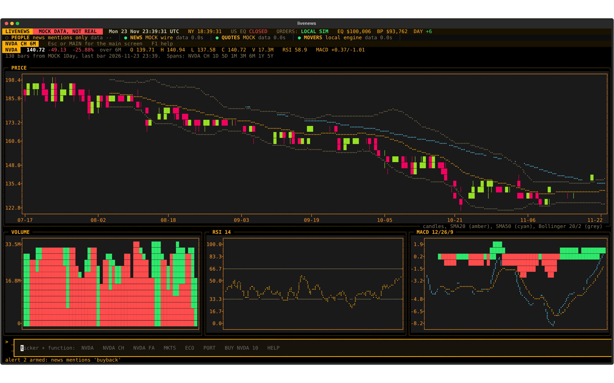
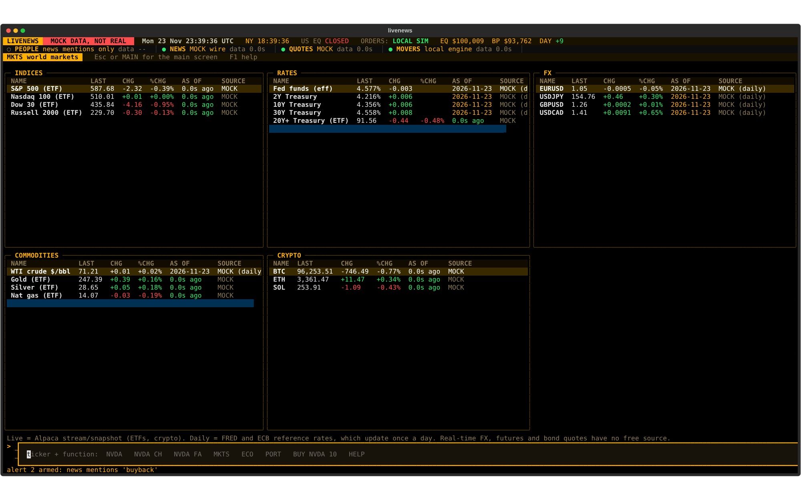
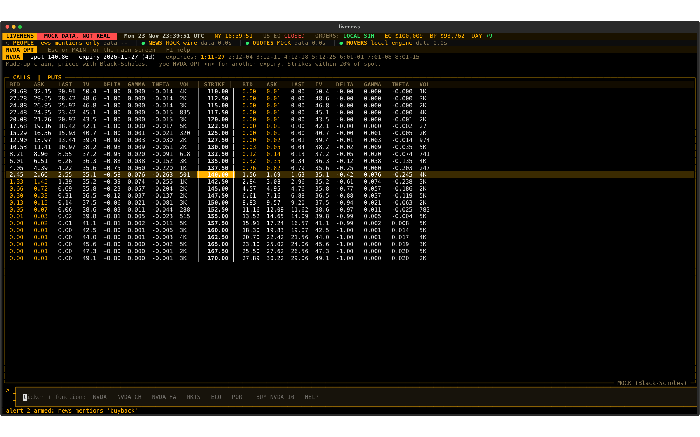

# livenews

A market terminal that runs in your shell. Live headlines, live prices, what's
moving and why, what Congress and Cramer are trading, and an order ticket
wired to Alpaca (paper by default).


*Screenshot is mock mode, so every number in it is made up.*

## Run it

```bash
pip install -r requirements.txt
python -m livenews --mock        # no keys, simulated market
cp .env.example .env             # then add your Alpaca paper keys
python -m livenews               # real data
```

Make the terminal window big. It's laid out for about 200x55.

## Using it

Type in the command line at the bottom. Ticker first, then a function code.
Esc (or `MAIN`) always brings you back to the main screen. `HELP` lists everything.

**Per ticker**

| Type | Screen |
|---|---|
| `NVDA` | quote on the main screen, and starts streaming it |
| `NVDA N` | news panel shows only NVDA (`N` for all) |
| `NVDA CH [1D 5D 1M 3M 6M 1Y 5Y]` | candle chart with volume, RSI, MACD. SMA 20/50 and Bollinger bands on daily, VWAP on intraday |
| `NVDA DES` | company profile, market cap, recent SEC filings with links |
| `NVDA FA` / `NVDA FA Q` | income, cash flow and balance sheet lines, annual or quarterly, with margins and growth |
| `NVDA EST` | analyst rating counts by month, EPS actual vs estimate, key ratios |
| `NVDA INS` | insider buys and sells (Form 4) for the last year |
| `NVDA OPT [n]` | options chain with IV and greeks, nearest expiry or expiry number n |
| `BTC/USD CH` | crypto pairs work for charts too |

**Market-wide**

| Type | Screen |
|---|---|
| `MKTS` (or `FX`, `RATES`, `CMDTY`, `CRYPTO`) | indices, Treasury yields, Fed funds, FX, oil, gold, crypto |
| `ECO [days]` | economic release calendar plus earnings dates for your watchlist |
| `PORT` | positions, P&L, beta, volatility, value at risk, concentration |
| `ORD` | every order and every fill, with submit-to-fill time |
| `W` / `W ADD AMD` / `W DEL AMD` / `W USE tech` | watchlists, saved between runs |
| `ALRT NVDA > 150` / `ALRT NVDA MOVE 5` / `ALRT NEWS FDA [NVDA]` / `ALRT DEL 2` | alerts: beep, pop-up, logged. Each fires once |
| `PPL [name]` | congressional trades and commentator mentions |

**Orders** (a ticket always opens for you to confirm)

| Type | Order |
|---|---|
| `BUY NVDA 10` | market |
| `BUY NVDA 10 LMT 140` | limit |
| `SELL NVDA 10 STP 130` | stop |
| `SELL NVDA 10 STP 130 LMT 129` | stop limit |
| `SELL NVDA 10 TRAIL 3` | 3% trailing stop |
| add `GTC` | good till cancelled (default is DAY) |
| `CXL ALL` / `CXL <id>` | cancel |

Keys: F1 help, F2 main, F3 markets, F4 calendar, F5 portfolio, F6 orders,
F7 watchlist, F8 chart the selected ticker, F9 command line. Enter on any row
(a mover, a headline, a filing) pulls up that ticker.





## Keys per feature

Everything runs in `--mock` with no keys. For real data:

| Feature | Needs | Cost |
|---|---|---|
| News wire, live prices, movers, charts, crypto, options chains, paper orders, live fills | `ALPACA_API_KEY_ID` + `ALPACA_API_SECRET_KEY` | free |
| Treasury yields, Fed funds, SOFR, oil, gas, economic calendar | `FRED_API_KEY` | free |
| FX rates | nothing (ECB via Frankfurter) | free |
| Financial statements, filings, company profile | `LIVENEWS_SEC_USER_AGENT` (your name + email, SEC rule) | free |
| Analyst ratings, EPS surprises, insider trades, earnings dates, second news wire | `FINNHUB_API_KEY` | free tier |
| Congressional trades | `FMP_API_KEY` | may need a paid plan |

When a key is missing, that screen says which one to set rather than failing silently.

## What isn't here, and why

- **Chat / messaging.** That's Bloomberg's own network. Nothing to connect to.
- **Real-time FX, futures, bonds.** No free real-time source exists. FX here is
  the ECB's daily reference rate, rates and oil are FRED daily closes, and
  live moves come from ETF proxies (TLT, GLD, USO, UUP and so on), labelled as such.
- **Analyst price targets, estimate revisions, institutional holders (13F).**
  Paid on every provider I checked. Finnhub's free tier gives rating counts
  and EPS surprises, which is what EST shows.
- **Options quotes are "indicative".** Alpaca's free options feed is
  approximate and can lag. Fine for scanning, check the real quote before
  trading. Options orders aren't wired up; the order ticket is stocks only.
- **Event times on the calendar.** FRED publishes release dates, not times.

## Where the data comes from, and how fresh it is

The second line of the screen shows every feed: source, age of the newest
datapoint, and round-trip time. Green dot means it answered in the last 15s.
Red means it's failing and the error is in the LOG panel.

**News**
- Alpaca news WebSocket (Benzinga). Headlines are pushed the moment Alpaca
  gets them, usually a second or two after publication.
- Alpaca news REST, polled every 1s as a backstop in case the socket drops.
  Duplicates are dropped by id.
- Finnhub general news, optional, polled every 2s. Free tier is 60 calls/min.

**Prices**
- Alpaca trade WebSocket for your watchlist plus whatever you look up. Every
  trade updates the price as it prints. The free plan allows 30 symbols on
  the stream, so the oldest looked-up ticker gets dropped past that.
- Alpaca snapshots every 2s for everything else on screen (movers,
  most-actives, tickers in recent news), up to 200 symbols.
- Free plan prices are IEX only. That's real time, but IEX is one exchange
  with a few percent of US volume. Prices can be a cent or two off the
  consolidated tape and volumes are much smaller than what you'd see on a
  chart site. `ALPACA_FEED=sip` fixes that if you pay for Alpaca's data plan.

**Movers**
- Alpaca's screener (top gainers/losers, most active) every 5s. Alpaca
  refreshes it about once a minute on their side.
- The local engine then ranks everything it has a price for:
  - GAINERS / LOSERS: percent change vs yesterday's close
  - VOLUME: RVOL (today's volume vs yesterday's, adjusted for how far into
    the session we are) and 1M× (the last minute bar vs the average of the
    previous ones)
  - HOT: move size x volume x headline count in the last hour. A 3% move on
    4x volume with two headlines ranks above a 6% move nobody is trading.

**Rate limits.** Alpaca's free data plan is 200 requests/min. With the
defaults the main screen uses about 115 to 145/min (news 60, screener 24,
snapshots 30 or 60 depending on how many tickers are on screen). Function
screens add a few calls when they open and refresh (MKTS every 5s, options
every 15s, charts every 15s intraday). One shared limiter holds everything
under 180, so heavy use slows screens down rather than getting you blocked.
FRED, SEC and Finnhub responses are cached (1h, 6h and 10min).

**People**
- Congress trades come from STOCK Act filings via Financial Modeling Prep
  (`FMP_API_KEY`). Members have up to 45 days to file, so these are never
  live. Each row shows the filing date and the LAG between trade and filing.
  Polled every 15 min. I couldn't confirm which FMP plan includes these
  endpoints, so it may need a paid tier. If the key doesn't have access the
  feed goes red and the LOG says so.
- Cramer and anyone else in `LIVENEWS_PEOPLE` are matched by name in the news
  wire. Benzinga writes up a lot of what Cramer says on air, so this catches
  most of it within the hour, at no extra cost. It's a headline match, not a
  structured pick list.

## Trading

- Paper is the default. Paper keys go to `paper-api.alpaca.markets`.
- Live needs `LIVENEWS_TRADING_MODE=live` **and**
  `LIVENEWS_ALLOW_LIVE=yes-i-understand`, plus live keys. Live with mock data
  is refused outright.
- Every order opens a ticket you have to confirm, including stops and trailing stops. In live mode the Send button
  stays disabled until you type the ticker.
- Before anything is sent: orders over `LIVENEWS_MAX_ORDER_VALUE` are
  refused, limit prices more than 10% from last are refused as likely typos,
  and you can't place an order on a ticker with no price yet.
- Each Alpaca order carries a unique `client_order_id` so a retried request
  can't fill twice.
- Fills come in over Alpaca's `trade_updates` stream as they happen, and
  `ORD` shows each one with how long it took from submit to fill.
- A buy stop below the market (or sell stop above it) is refused because it
  would trigger the moment it lands.
- In mock mode a local simulator fills market orders at the simulated price.

## Tests

```bash
pip install -r requirements-dev.txt
pytest
```

The tests cover the config safety switches, order checks and stop logic,
the command parser, every API response parser (including the function-screen
providers against canned responses), indicator math against reference values,
Black-Scholes, SEC statement extraction, portfolio risk, alerts, watchlist
persistence, and the UI (every function screen opens without errors, the
ticket flow, live ticket stays locked until the ticker is typed).

## Layout

```
livenews/
  config.py          env vars, paper/live switches
  store.py           shared state, feed health
  engine.py          RVOL, minute spikes, ranking
  commands.py        command line grammar
  sources/
    alpaca.py        REST: news, screener, snapshots
    alpaca_stream.py WebSocket: news, trades, minute bars
    finnhub.py       second news wire
    people.py        Congress filings + name matching in news
    mock.py          simulated market for --mock
  broker/
    base.py          order checks
    alpaca.py        Alpaca trading API
    sim.py           local fill simulator
  indicators.py      SMA EMA RSI MACD Bollinger VWAP ATR
  risk.py            beta, vol, VaR, drawdown, concentration
  options_math.py    OCC symbols, Black-Scholes
  userdata.py        watchlists and alerts (~/.livenews)
  hub/
    live.py          Alpaca, FRED, Frankfurter, SEC, Finnhub for function screens
    sec.py           XBRL statement extraction
    mock.py          made-up data for every screen
  sources/trade_updates.py  live order events
  ui/app.py          the terminal
  ui/views.py        function screens (CH MKTS ECO DES FA EST INS OPT PORT ORD W)
```
