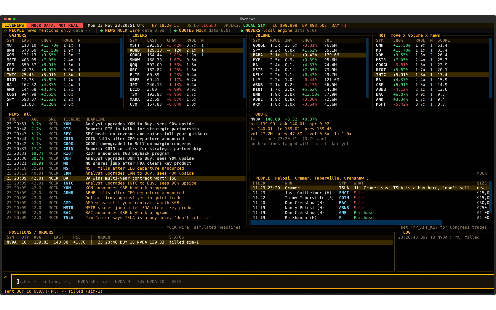
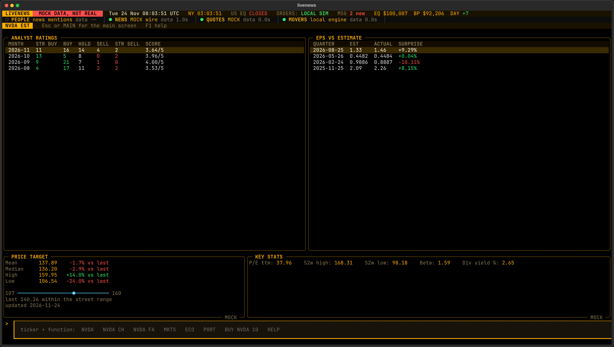
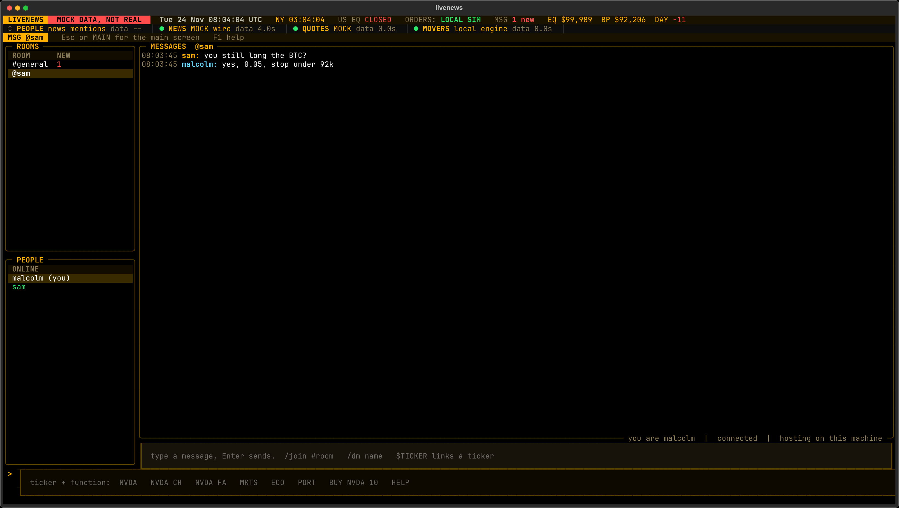

# livenews

A market terminal that runs in your shell. Live headlines, live prices, what's
moving and why, what Congress and Cramer are trading, futures and FX, a chat
between your terminals, and an order ticket for stocks, options and crypto
wired to Alpaca (paper by default).



*Screenshot is mock mode, so every number in it is made up.*

## Run it

```bash
pip install -r requirements.txt
python -m livenews --mock        # no keys, simulated market
cp .env.example .env             # then add your Alpaca paper keys
python -m livenews               # real data
```

Make the terminal window big. It's laid out for about 200x55.

## Using it

Type in the command line at the bottom. Ticker first, then a function code.
Esc (or `MAIN`) always brings you back to the main screen. `HELP` lists everything.

**Per ticker**

| Type | Screen |
|---|---|
| `NVDA` | quote on the main screen, and starts streaming it |
| `NVDA N` | news panel shows only NVDA (`N` for all) |
| `NVDA CH [1D 5D 1M 3M 6M 1Y 5Y]` | candle chart with volume, RSI, MACD. SMA 20/50 and Bollinger bands on daily, VWAP on intraday |
| `NVDA DES` | company profile, market cap, recent SEC filings with links |
| `NVDA FA` / `NVDA FA Q` | income, cash flow and balance sheet lines, annual or quarterly, with margins and growth |
| `NVDA EST` | street price target (mean, median, high, low, where the stock sits in the range), analyst rating counts by month, EPS actual vs estimate, key ratios |
| `NVDA INS` | insider buys and sells (Form 4) for the last year |
| `NVDA OWN` | institutional holders from the latest 13F filings: who, how many shares, value, % of shares out |
| `NVDA OPT [n]` | options chain with IV and greeks, nearest expiry or expiry number n. Press B or S on a contract to trade it |
| `BTC/USD` | crypto quotes stream live and trade like anything else |
| `ES=F` `^VIX` `EURUSD=X` `CL=F` | futures, indices, FX and commodities open a chart (delayed, see below) |
| `NVDA260116C00150000` | an option contract by its OCC symbol opens its chain |

**Market-wide**

| Type | Screen |
|---|---|
| `MKTS` (or `FX`, `RATES`, `CMDTY`, `CRYPTO`) | world indices, index/rate/dollar futures, Treasury yields, Fed funds, FX, energy, metals, grains, crypto. Enter on any row charts it |
| `ECO [days]` | economic releases with their usual ET release time, plus earnings dates (pre/post market) for your watchlist |
| `PORT` | positions, P&L, beta, volatility, value at risk, concentration |
| `ORD` | every order and every fill, with submit-to-fill time |
| `W` / `W ADD AMD` / `W DEL AMD` / `W USE tech` | watchlists, saved between runs |
| `ALRT NVDA > 150` / `ALRT NVDA MOVE 5` / `ALRT NEWS FDA [NVDA]` / `ALRT DEL 2` | alerts: beep, pop-up, logged. Each fires once |
| `PPL [name]` | congressional trades and commentator mentions |
| `MSG` / `MSG #desk` / `MSG hi all` / `MSG @sam look at $NVDA` | chat with other livenews terminals: rooms, direct messages, history |

**Orders** (a ticket always opens for you to confirm)

| Type | Order |
|---|---|
| `BUY NVDA 10` | market |
| `BUY NVDA 10 LMT 140` | limit |
| `SELL NVDA 10 STP 130` | stop |
| `SELL NVDA 10 STP 130 LMT 129` | stop limit |
| `SELL NVDA 10 TRAIL 3` | 3% trailing stop |
| add `GTC` | good till cancelled (default is DAY) |
| `BUY BTC/USD 0.05` | crypto, fractional, market/limit/stop-limit, always GTC |
| `BUY NVDA260116C00150000 2 LMT 4.10` | 2 option contracts, market or limit, DAY |
| `CXL ALL` / `CXL <id>` | cancel |

Keys: F1 help, F2 main, F3 markets, F4 calendar, F5 portfolio, F6 orders,
F7 watchlist, F8 chart the selected ticker, F9 command line, F10 chat. Enter
on any row (a mover, a headline, a filing) pulls up that ticker.





## Keys per feature

Everything runs in `--mock` with no keys. For real data:

| Feature | Needs | Cost |
|---|---|---|
| News wire, live stock and crypto prices, movers, charts, options chains, paper orders, live fills | `ALPACA_API_KEY_ID` + `ALPACA_API_SECRET_KEY` | free |
| World indices, futures, Treasury yields, commodities, FX (delayed) | nothing (Yahoo chart data) | free |
| Streaming FX and gold/silver | `FINNHUB_API_KEY` | free tier |
| Fed funds, SOFR, official daily rates, economic calendar | `FRED_API_KEY` | free |
| FX fallback | nothing (ECB via Frankfurter) | free |
| Financial statements, filings, profile, institutional holders (13F) | `LIVENEWS_SEC_USER_AGENT` (your name + email, SEC rule) | free |
| Analyst ratings, EPS surprises, insider trades, earnings dates, second news wire | `FINNHUB_API_KEY` | free tier |
| Price targets | `FINNHUB_API_KEY` on a paid plan, or `FMP_API_KEY` | depends on plan |
| House members' trades | nothing (House Clerk filings) | free |
| Senators' trades | `FMP_API_KEY` | may need a paid plan |
| Chat | nothing | free |

When a key is missing, that screen says which one to set rather than failing silently.

## Limits worth knowing

- **Futures, world indices and yields are delayed.** They come from Yahoo's
  chart endpoint, which is unofficial and meant for personal use. CME futures
  run about 10 minutes behind, most indices 0 to 15. Every row shows the time
  of its last print so you always see the real delay. Treasuries are shown as
  yields (and ZN/ZB futures), not dealer bond prices.
- **FX** streams from OANDA through Finnhub when you have a Finnhub key.
  Without one it falls back to Yahoo (delayed), then to the ECB daily rate.
- **Price targets** are a paid endpoint at Finnhub. On a free key EST tries
  FMP's consensus target instead, and if neither key can see it the panel
  says exactly that.
- **Congress trades lag.** Members have up to 45 days to file. House reports
  come straight from the Clerk's PDFs; paper filings that were scanned as
  images can't be read without OCR, so they show as "PDF only" with the link.
  Senate filings sit behind a click-through on efdsearch.senate.gov, so those
  come from FMP if you have a key.
- **13F holders lag too.** Funds file 45 days after quarter end. The first
  time you open OWN it downloads the SEC's quarterly 13F data set (around
  100 MB) and indexes it, which takes a minute or two. After that it's local
  and instant until the next quarter.
- **Options quotes are "indicative".** Alpaca's free options feed is
  approximate and can lag. Fine for scanning, check the real quote before
  sending a market order. Your Alpaca account needs options enabled to trade them.
- **Chat is between livenews terminals.** It isn't connected to any outside
  network. See "Chat" below for running it across machines.
- **Calendar times are the usual slots** (08:30 for CPI and payrolls, 10:00
  for JOLTS, 14:00 for the Fed). FRED publishes dates, not times, and an
  agency can move a release.

## Where the data comes from, and how fresh it is

The second line of the screen shows every feed: source, age of the newest
datapoint, and round-trip time. Green dot means it answered in the last 15s.
Red means it's failing and the error is in the LOG panel.

**News**
- Alpaca news WebSocket (Benzinga). Headlines are pushed the moment Alpaca
  gets them, usually a second or two after publication.
- Alpaca news REST, polled every 1s as a backstop in case the socket drops.
  Duplicates are dropped by id.
- Finnhub general news, optional, polled every 2s. Free tier is 60 calls/min.

**Prices**
- Alpaca trade WebSocket for your watchlist plus whatever you look up. Every
  trade updates the price as it prints. The free plan allows 30 symbols on
  the stream, so the oldest looked-up ticker gets dropped past that.
- Alpaca snapshots every 2s for everything else on screen (movers,
  most-actives, tickers in recent news), up to 200 symbols.
- Free plan prices are IEX only. That's real time, but IEX is one exchange
  with a few percent of US volume. Prices can be a cent or two off the
  consolidated tape and volumes are much smaller than what you'd see on a
  chart site. `ALPACA_FEED=sip` fixes that if you pay for Alpaca's data plan.

**Crypto**
- Alpaca's crypto WebSocket for every pair on your watchlist or that you look
  up, plus a snapshot poll as backstop. Real time, 24/7. Day change is against
  the previous UTC day. Crypto stays out of the movers ranking because
  session-adjusted volume means nothing for something that never closes.

**Markets screen**
- Stock index ETFs and crypto from Alpaca in real time, everything else from
  Yahoo (delayed), OANDA via Finnhub (streaming FX), FRED and the ECB
  (official daily values). The SOURCE and AS OF columns say which and how old.

**Movers**
- Alpaca's screener (top gainers/losers, most active) every 5s. Alpaca
  refreshes it about once a minute on their side.
- The local engine then ranks everything it has a price for:
  - GAINERS / LOSERS: percent change vs yesterday's close
  - VOLUME: RVOL (today's volume vs yesterday's, adjusted for how far into
    the session we are) and 1M× (the last minute bar vs the average of the
    previous ones)
  - HOT: move size x volume x headline count in the last hour. A 3% move on
    4x volume with two headlines ranks above a 6% move nobody is trading.

**Rate limits.** Alpaca's free data plan is 200 requests/min. With the
defaults the main screen uses about 115 to 145/min (news 60, screener 24,
snapshots 30 or 60 depending on how many tickers are on screen). Function
screens add a few calls when they open and refresh (MKTS every 5s, options
every 15s, charts every 15s intraday). One shared limiter holds everything
under 180, so heavy use slows screens down rather than getting you blocked.
FRED, SEC and Finnhub responses are cached (1h, 6h and 10min).

**People**
- House trades come straight from the House Clerk: the yearly disclosure
  index, then each periodic transaction report PDF for the people you track
  (ticker, buy/sell, trade date, amount range). Checked every 30 min, and each
  PDF is read once and cached in `~/.livenews/house`. Each row shows the filing
  date and the LAG between trade and filing.
- Senate trades come from Financial Modeling Prep (`FMP_API_KEY`), polled every
  15 min. I couldn't confirm which FMP plan includes that endpoint, so it may
  need a paid tier. If the key doesn't have access the feed goes red and the
  LOG says so.
- Cramer and anyone else in `LIVENEWS_PEOPLE` are matched by name in the news
  wire. Benzinga writes up a lot of what Cramer says on air, so this catches
  most of it within the hour, at no extra cost. It's a headline match, not a
  structured pick list.

## Trading

- Paper is the default. Paper keys go to `paper-api.alpaca.markets`.
- Live needs `LIVENEWS_TRADING_MODE=live` **and**
  `LIVENEWS_ALLOW_LIVE=yes-i-understand`, plus live keys. Live with mock data
  is refused outright.
- Every order opens a ticket you have to confirm, including stops and trailing stops. In live mode the Send button
  stays disabled until you type the ticker.
- Before anything is sent: orders over `LIVENEWS_MAX_ORDER_VALUE` are
  refused, limit prices more than 10% from last are refused as likely typos,
  and you can't place an order on a ticker with no price yet.
- Each Alpaca order carries a unique `client_order_id` so a retried request
  can't fill twice.
- Fills come in over Alpaca's `trade_updates` stream as they happen, and
  `ORD` shows each one with how long it took from submit to fill.
- A buy stop below the market (or sell stop above it) is refused because it
  would trigger the moment it lands.
- In mock mode a local simulator fills market orders at the simulated price.
- Options: whole contracts, market or limit, DAY only. The ticket shows the mid
  and the value is priced at 100 shares per contract, so the max order value
  check means what it says. Limits more than 50% from the mid are refused
  (option spreads are wide, 10% would block real orders). On the OPT screen,
  B or S on a contract fills in the order line for you; nothing is sent until
  you press Enter and confirm the ticket. In mock mode options fill at the
  Black-Scholes mid and settle at intrinsic value after expiry.
- Crypto: fractional sizes, market, limit or stop-limit. Alpaca only takes GTC
  or IOC for crypto, so DAY is switched to GTC and the ticket says so.
- Index, futures and FX symbols are data only and can't be ordered.

## Chat

`MSG` (or F10) opens the chat. Rooms start with `#`, direct messages with `@`.
Type `$NVDA` in a message and the ticker gets highlighted. History is kept in
`~/.livenews/chat.jsonl` on whichever machine hosts the relay.

The first terminal you open on a machine hosts a small relay on
`127.0.0.1:8765` and every other terminal on that machine joins it. To chat
across machines, run the relay somewhere everyone can reach and point the
terminals at it:

```bash
# on the host
LIVENEWS_CHAT_TOKEN=pick-a-long-secret python -m livenews.chat --host 0.0.0.0 --port 8765
# on each desk
LIVENEWS_CHAT_URL=ws://host:8765 LIVENEWS_CHAT_TOKEN=pick-a-long-secret LIVENEWS_CHAT_NAME=sam python -m livenews
```

Hosting beyond localhost refuses to start without a token. The relay speaks
plain `ws://`, so across the internet put it behind something that terminates
TLS (Caddy, nginx, a tunnel) and use `wss://`. `LIVENEWS_CHAT=off` disables chat.

## Tests

```bash
pip install -r requirements-dev.txt
pytest
```

The tests cover the config safety switches, order checks and stop logic
(stocks, options, crypto), the command parser, every API response parser
(including the function-screen providers, Yahoo, the House Clerk index and
PTR text, and the price target fallback, all against canned responses), the
13F index on a small synthetic data set, the chat relay with two clients,
indicator math against reference values, Black-Scholes, option settlement in
the simulator, SEC statement extraction, portfolio risk, alerts, watchlist
persistence, and the UI (every function screen opens without errors, the
ticket flow for stocks, options and crypto, live ticket stays locked until the
ticker is typed, chat send and receive).

None of this has been run against the real APIs from here; the tests use
recorded response shapes. The first run with your keys is the real check, and
the feed line at the top tells you right away if something is off.

## Layout

```
livenews/
  config.py          env vars, paper/live switches
  store.py           shared state, feed health
  engine.py          RVOL, minute spikes, ranking
  commands.py        command line grammar
  sources/
    alpaca.py        REST: news, screener, snapshots
    alpaca_stream.py WebSocket: news, stock and crypto trades, minute bars
    finnhub.py       second news wire
    finnhub_ws.py    streaming FX and metals
    house.py         House Clerk disclosure index and PTR PDFs
    people.py        Congress filings + name matching in news
    mock.py          simulated market for --mock
  broker/
    base.py          order checks
    alpaca.py        Alpaca trading API
    sim.py           local fill simulator
  indicators.py      SMA EMA RSI MACD Bollinger VWAP ATR
  risk.py            beta, vol, VaR, drawdown, concentration
  options_math.py    OCC symbols, Black-Scholes
  userdata.py        watchlists and alerts (~/.livenews)
  hub/
    live.py          Alpaca, FRED, Frankfurter, SEC, Finnhub, FMP for function screens
    delayed.py       Yahoo chart data: indices, futures, yields, FX
    thirteenf.py     SEC 13F data set -> SQLite -> holders
    sec.py           XBRL statement extraction
    mock.py          made-up data for every screen
  sources/trade_updates.py  live order events
  chat.py            chat relay and client
  ui/app.py          the terminal
  ui/views.py        function screens (CH MKTS ECO DES FA EST INS OWN OPT PORT ORD W MSG)
```
